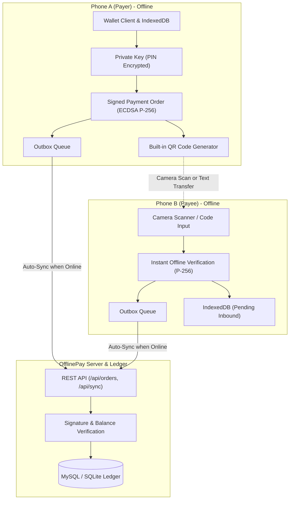

# ⚡ OfflinePay

[](https://nodejs.org/)
[](https://web.dev/progressive-web-apps/)
[](https://www.w3.org/TR/WebCryptoAPI/)
[](https://www.mysql.com/)
[](https://nodejs.org/api/test.html)
[](LICENSE)

An offline-first, Google Pay / UPI–style payment wallet built as a Progressive Web App (PWA). **OfflinePay** enables two mobile devices to complete secure, cryptographically verified peer-to-peer payments even when neither phone has an internet or cellular connection.

When connectivity returns, either device automatically synchronizes pending transactions to the server, where each transaction is settled idempotently in a durable ledger (MySQL or SQLite).

> [!NOTE]
> **Play / Educational Money Only:** This application is an educational prototype and reference implementation. The "Add Money" feature operates via an in-app faucet. Moving real fiat currency requires integration with banking APIs, payment processors (e.g., Stripe, Razorpay, UPI PSPs), and regulatory compliance (KYC, AML, PCI-DSS).

---

## Table of Contents

- [Core Features](#core-features)
- [System Architecture](#system-architecture)
- [How Offline Payments Work](#how-offline-payments-work)
  - [1. Wallet Creation & Identity](#1-wallet-creation--identity)
  - [2. Offline Transaction Signing](#2-offline-transaction-signing)
  - [3. Peer-to-Peer Transfer (QR / Text Code)](#3-peer-to-peer-transfer-qr--text-code)
  - [4. Reconciliation & Idempotent Settlement](#4-reconciliation--idempotent-settlement)
- [Cryptographic Security Model](#cryptographic-security-model)
- [Tech Stack & Project Layout](#tech-stack--project-layout)
- [Prerequisites & Requirements](#prerequisites--requirements)
- [Installation & Quick Start](#installation--quick-start)
  - [Option A: Running with MySQL (Default)](#option-a-running-with-mysql-default)
  - [Option B: Running with SQLite (Zero Configuration)](#option-b-running-with-sqlite-zero-configuration)
- [Quick 2-Minute Offline Simulation](#quick-2-minute-offline-simulation)
- [Mobile Device Setup & PWA Installation](#mobile-device-setup--pwa-installation)
  - [Android via USB Port Forwarding](#android-via-usb-port-forwarding-easiest)
  - [HTTPS Tunnel (Cloudflare Tunnel / ngrok)](#https-tunnel-cloudflare-tunnel--ngrok)
  - [PWA Home Screen Installation](#pwa-home-screen-installation)
- [Database Schema & Architecture](#database-schema--architecture)
  - [Users Table](#users-table)
  - [Ledger Table](#ledger-table)
  - [Built-in DBMS Inspector](#built-in-dbms-inspector)
  - [SQL Inspection Queries](#sql-inspection-queries)
- [Configuration Reference](#configuration-reference)
  - [Client & Protocol Settings (`public/js/config.js`)](#client--protocol-settings-publicjsconfigjs)
  - [Server Environment Variables (`.env`)](#server-environment-variables-env)
- [API Documentation](#api-documentation)
- [Automated Testing](#automated-testing)
- [Production Considerations & Hardening](#production-considerations--hardening)
- [Troubleshooting](#troubleshooting)

---

## Core Features

- 📱 **True Offline-First Architecture**: Service Worker caches 100% of the application shell. The app boots, signs payments, verifies receipts, and displays transaction history with zero network connection.
- 🔐 **Non-Custodial Device Wallet**: ECDSA P-256 cryptographic key pairs are generated locally in the browser via WebCrypto. The private key never leaves the client device.
- 🛡️ **Hardware/PIN Key Encryption**: Private keys are sealed with AES-256-GCM using a key derived from a 6-digit user PIN via PBKDF2 (200,000 SHA-256 rounds + 16-byte random salt).
- 📷 **Built-In Zero-Dependency QR Generator & Scanner**: Includes a vanilla JS QR code engine (`public/js/qr.js`) with Reed-Solomon error correction and native camera scanning via the `BarcodeDetector` API (with fallback to copyable alphanumeric codes).
- 🔄 **Idempotent Dual-Delivery Sync**: A signed payment order can be delivered by the payer, the receiver, or both. The backend settles each order ID exactly once with atomic balance updates.
- 💰 **Double-Spend Prevention (Client & Server)**: Spendable balance is calculated as `Settled Balance - Pending Outgoing Orders`. Payer balances decrease immediately upon signing, preventing local overspending.
- 🗄️ **Dual Database Backends**:
  - **MySQL (Production)**: Connection pooling via `mysql2/promise` with InnoDB transactions and foreign-key constraints.
  - **SQLite (Development/Testing)**: Embedded, high-performance WAL-mode database via `better-sqlite3`.
- 🔍 **Live In-App DBMS Dashboard**: Inspect database health, connection status, table row counts, and execute read-only SQL queries (`SELECT`, `PRAGMA`, `EXPLAIN`) directly from `#/dbms`.
- ⚡ **Background Sync API**: Leverages the Service Worker Background Sync API (`opay-sync`) on supported browsers to deliver queued payments in the background once internet connectivity is restored.

---

## System Architecture



---

## How Offline Payments Work

### 1. Wallet Creation & Identity
1. Upon initial launch, the user provides a display name and sets a 6-digit PIN.
2. WebCrypto creates an ECDSA P-256 key pair.
3. The user's public ID is deterministically generated from `SHA-256(publicKey)` encoded into Crockford Base32 with a 2-character checksum (formatted as `XXXX-XXXX-XXXX`, e.g., `1J6J-BEJ7-SZCZ`).
4. Because the ID is derived from the public key, no central server is needed to claim or verify identity, and typos are detected before a transaction is signed.

### 2. Offline Transaction Signing
1. The payer enters the recipient's 12-character ID, payment amount, and an optional note.
2. The user confirms the payment with their 6-digit PIN.
3. The app decrypts the private key into memory as a non-extractable key object.
4. An order object is constructed and signed:
   ```json
   {
     "v": 1,
     "i": "HISMybVNXQHS6wTsG7Dcrg",
     "f": "6E8A96GQAKR3",
     "t": "5H13DFD9J86G",
     "a": 2500,
     "c": "USD",
     "s": 1793621189,
     "n": "Dinner",
     "fn": "Alice",
     "k": "BDggPrWF03tVNE0_D_ZbGDVpp1Ahg...",
     "g": "PEFSsJkWRkM-4urlw4gw3eruUgCM2..."
   }
   ```
5. The transaction is saved to the local IndexedDB outbox as **pending**, and the payer's available balance is immediately deducted locally.

### 3. Peer-to-Peer Transfer (QR / Text Code)
1. The payer's screen displays the signed payload as a dynamic QR code (or compact alphanumeric text format: `OPAY1:<base64url>`).
2. The payee scans the QR code using their phone camera (or pastes the text code).
3. The payee's app verifies:
   - Valid signature matching the embedded public key `k`.
   - Public key `k` hashes to the sender ID `f`.
   - The recipient ID `t` matches the payee's own wallet ID.
   - The currency matches (`USD`).
   - The timestamp is within the acceptable clock skew (max 10 min future) and validity window (max 24 hours).
4. The payee sees **"Code checked on this phone"** with a green badge. The payment is added to their local incoming ledger as **pending**.

### 4. Reconciliation & Idempotent Settlement
1. When either phone reconnects to the network, its outbox flushes automatically to `/api/orders`.
2. The server verifies the ECDSA signature and checks the payer's confirmed balance.
3. **Atomic Balance Update**: If the payer has sufficient funds, the server deducts from the payer, credits the payee, and records the entry as `settled`.
4. **Idempotency**: Orders are keyed by unique UUID `i`. Duplicate submissions (e.g., both phones submitting the same order) return the existing settlement result without double-crediting.
5. Clients query `/api/sync` using an authenticated ECDSA signature to download newly settled ledger entries and sync their balances.

---

## Cryptographic Security Model

| Component | Standard / Algorithm | Details |
|---|---|---|
| **Digital Signatures** | ECDSA (NIST P-256 / secp256r1) | Uses SHA-256 digest via W3C Web Cryptography API (`globalThis.crypto.subtle`). |
| **PIN Key Derivation** | PBKDF2 with HMAC-SHA-256 | 200,000 iterations using a cryptographically random 16-byte salt. |
| **At-Rest Key Encryption** | AES-256-GCM | Authenticated symmetric encryption with random 12-byte IV per encryption operation. |
| **In-Memory Key Protection** | Non-Extractable CryptoKey | Decrypted private keys cannot be exported via JavaScript. |
| **Account Identifiers** | Crockford Base32 + Modulo 1024 Checksum | Excludes ambiguous characters (`I`, `L`, `O`, `U`). Typo-tolerant normalization. |
| **Brute-Force Guard** | Client-Side Exponential Lockout | 5 failed attempts trigger rate-limiting delays starting at 30 seconds up to 15 minutes. |
| **HTTP Security Headers** | CSP, HSTS, X-Content-Type-Options | Strict Content Security Policy (`default-src 'self'`), frame sandboxing (`DENY`), and permission policies. |

---

## Tech Stack & Project Layout

```
offline-pay/
├── server.js               # Main HTTP/HTTPS server, static file router, SQLite engine
├── mysql-server.js         # Production MySQL-backed database server
├── package.json            # Node.js dependencies and script definitions
├── package-lock.json       # Locked dependency tree
├── .env.example            # Template for environment configuration
├── .gitignore              # Ignores .env, node_modules, and runtime database files
│
├── sql/
│   ├── schema.mysql.sql    # MySQL database & table definitions (InnoDB)
│   └── inspect.sql         # Diagnostic and reporting queries for DB inspection
│
├── public/                 # Client PWA application shell (cached by Service Worker)
│   ├── index.html          # Single-page application entry point
│   ├── manifest.webmanifest# Progressive Web App manifest
│   ├── sw.js               # Service Worker: caching, asset fingerprinting, Background Sync
│   ├── css/
│   │   └── styles.css      # Dark-mode UI styles, typography, and responsive layouts
│   ├── icons/              # PWA app icons (192px, 512px, maskable)
│   └── js/
│       ├── app.js          # App controller, view rendering, routing, navigation
│       ├── ui.js           # UI templates, modals, sheets, notifications, toasts
│       ├── wallet.js       # Wallet client state machine (pure logic, no DOM)
│       ├── protocol.js     # Wire format, Crockford Base32 IDs, signing, verification
│       ├── crypto.js       # PBKDF2 derivation, AES-GCM vault, ECDSA key generation
│       ├── db.js           # IndexedDB wrapper (with memory fallback)
│       ├── qr.js           # Vanilla JS QR code generator (Reed-Solomon encoding)
│       ├── scanner.js      # Video stream capture & BarcodeDetector QR scanning
│       ├── config.js       # Shared limits, timing windows, currency settings
│       ├── errors.js       # Structured error handling classes
│       ├── format.js       # Currency, date, and string formatting utilities
│       └── vendor/         # Optional external libraries (jsQR fallback)
│
├── test/
│   ├── e2e.test.js         # End-to-end multi-wallet lifecycle, online/offline sync tests
│   ├── protocol.test.js    # Cryptographic validation, order tampering, replay prevention
│   └── qr.test.js          # QR matrix dimensions, capacity tables, Reed-Solomon tests
│
└── tools/
    └── browser-check.mjs   # Headless multi-browser test harness (Playwright)
```

---

## Prerequisites & Requirements

- **Node.js**: v20.0.0 or higher (`node -v`)
- **npm**: v10.0.0 or higher
- **Modern Browser**: Google Chrome, Microsoft Edge, Safari, or Firefox (with JavaScript enabled)
- **Database (Optional for dev, recommended for prod)**:
  - MySQL Server 8.0+ (or MariaDB 10.5+) **OR**
  - SQLite (automatically managed via built-in `better-sqlite3`, requires no external server)

---

## Installation & Quick Start

1. **Clone the repository:**
   ```bash
   git clone https://github.com/KartikPanchal28/Offlinepay.git
   cd Offlinepay
   ```

2. **Install project dependencies:**
   ```bash
   npm install
   ```

### Option A: Running with MySQL (Default)

1. **Configure your database connection:**
   Copy `.env.example` to `.env`:
   ```bash
   cp .env.example .env
   ```
   Edit `.env` with your MySQL credentials:
   ```env
   MYSQL_HOST=127.0.0.1
   MYSQL_PORT=3306
   MYSQL_USER=root
   MYSQL_PASSWORD=your_mysql_password
   MYSQL_DATABASE=offlinepay
   PORT=3000
   ```

2. **Start the application:**
   ```bash
   npm start
   ```
   The server will automatically connect to MySQL, create the `offlinepay` database if it doesn't exist, and create the `users` and `ledger` tables.

3. **Open the app:**
   Navigate to [http://localhost:3000](http://localhost:3000).

### Option B: Running with SQLite (Zero Configuration)

If you do not have MySQL installed, you can start the application immediately using the embedded SQLite engine:

```bash
# Windows (PowerShell)
$env:DB_ENGINE="sqlite"; npm start

# Linux / macOS
DB_ENGINE=sqlite npm start
```

The database will be automatically created at `data/offlinepay.db` in high-performance WAL mode.

---

## Quick 2-Minute Offline Simulation

You can test the entire offline payment cycle on a single computer using two browser windows:

1. **Open two browser windows:**
   - Window A: Open `http://localhost:3000` (Normal Window)
   - Window B: Open `http://localhost:3000` (Incognito / Private Window)
2. **Create two accounts:**
   - Window A: Create user **Alice** with PIN `123456`.
   - Window B: Create user **Bob** with PIN `123456`.
3. **Fund Alice:**
   - In Window A, tap **Add money** and choose **$100**. Alice's balance becomes `$100.00`.
4. **Copy Bob's ID:**
   - In Window B, tap Bob's 12-character ID chip on the Home screen to copy it.
5. **Simulate Internet Disconnection:**
   - Stop the Node.js server in your terminal by pressing `Ctrl + C`. Both browsers are now completely disconnected from the server.
6. **Make an Offline Payment:**
   - In Window A (Alice), reload the page (it still loads instantly from the cache).
   - Tap **Send**, paste Bob's ID, enter `$25.00`, and confirm with PIN `123456`.
   - Alice sees a **Pending** receipt with a QR code and a button labeled **"Show code as text"**. Alice's spendable balance immediately updates to `$75.00`.
7. **Accept the Payment Offline:**
   - In Window B (Bob), tap **Scan**, choose **"Enter a code instead"**, and paste Alice's payment code.
   - Bob's app validates Alice's signature instantly with no internet: **"Code checked on this phone"**.
8. **Restore Connection & Settle:**
   - Restart the server in your terminal (`npm start`).
   - Within 15 seconds, both windows auto-sync with the server (or tap the **Status** chip in the top right corner).
   - Both transactions flip from **Pending** to **Settled**!

---

## Mobile Device Setup & PWA Installation

Mobile browsers enforce security policies: **WebCrypto, Service Workers, and Camera APIs are only permitted on `localhost` or HTTPS URLs**. Connecting directly via plain HTTP IP (e.g. `http://192.168.1.x:3000`) will display *"Secure page needed"*.

Use either of the following approaches:

### Android via USB Port Forwarding (Easiest)
1. Connect your Android phone to your computer with a USB cable.
2. Enable **USB Debugging** in Android Developer Options.
3. On your computer's Chrome browser, open:
   `chrome://inspect/#devices`
4. Click **Port forwarding...**, add rule: `3000` → `localhost:3000`, and check **Enable port forwarding**.
5. Open Chrome on your phone and browse to [http://localhost:3000](http://localhost:3000).

### HTTPS Tunnel (Cloudflare Tunnel / ngrok)
Expose your local development port through a secure, encrypted HTTPS tunnel:

```bash
# Using Cloudflare Tunnel (no account required)
npx cloudflared tunnel --url http://localhost:3000

# OR using ngrok
ngrok http 3000
```
Open the generated `https://...` URL on any mobile device.

### PWA Home Screen Installation
1. Tap the browser menu (three dots in Chrome/Edge, or Share button in iOS Safari).
2. Select **"Install App"** or **"Add to Home Screen"**.
3. OfflinePay will now launch full-screen like a native app and retain storage reliably.

---

## Database Schema & Architecture

The application database stores only settled state and immutable ledger records.

```
┌─────────────────────────────────┐        ┌─────────────────────────────────┐
│              USERS              │        │             LEDGER              │
├─────────────────────────────────┤        ├─────────────────────────────────┤
│ id: VARCHAR(12) [PK]            │◄───┐   │ seq: BIGINT [PK, AUTO_INC]      │
│ name: VARCHAR(80)               │    │   │ entry_id: VARCHAR(80) [UNIQUE]  │
│ pub: VARCHAR(100)               │    │   │ kind: VARCHAR(20)               │
│ balance: BIGINT                 │    └───┼── from_id: VARCHAR(12) [FK]     │
│ created_at: BIGINT              │        ├── to_id: VARCHAR(12) [FK]       │
└─────────────────────────────────┘        │ amount: BIGINT                  │
                                           │ note: VARCHAR(500)              │
                                           │ ts: BIGINT                      │
                                           │ status: VARCHAR(20)             │
                                           │ reason: VARCHAR(255)            │
                                           │ settled_at: BIGINT              │
                                           │ order_json: LONGTEXT            │
                                           └─────────────────────────────────┘
```

### Users Table
- `id`: 12-character Crockford Base32 primary key derived from `SHA-256(pub)`.
- `name`: User's display name.
- `pub`: Base64url-encoded raw ECDSA P-256 public key.
- `balance`: Total settled balance in integer minor units (e.g. cents: `$10.00` = `1000`).
- `created_at`: Epoch timestamp (ms).

### Ledger Table
- `seq`: Monotonically increasing sequence ID (used for paginated delta synchronization).
- `entry_id`: Unique transaction identifier (`UUID` or `topup:nonce`).
- `kind`: Type of entry (`pay` or `topup`).
- `from_id`: Sender user ID (foreign key referencing `users.id`, NULL for topups).
- `to_id`: Recipient user ID (foreign key referencing `users.id`).
- `amount`: Transaction amount in minor units.
- `note`: Cleaned payment memo.
- `ts`: Timestamp recorded by the client device when signed.
- `status`: Settlement status (`settled` or `failed`).
- `reason`: Failure explanation if rejected (e.g. `Insufficient funds`).
- `settled_at`: Timestamp recorded by the server upon settlement.
- `order_json`: The complete original signed JSON order payload.

### Built-in DBMS Inspector
Navigate to `#/dbms` within the application to access:
- Live database engine status and active connection type (MySQL vs. SQLite).
- Total registered accounts, ledger entry count, and aggregate circulating balance.
- Interactive SQL Query Console supporting safe read-only queries (`SELECT`, `PRAGMA`, `EXPLAIN`).

### SQL Inspection Queries
Run pre-written inspection queries against your MySQL database using [sql/inspect.sql](file:///c:/Users/Kartik%20Panchal/OneDrive/Documents/java%20project/kartik/offline-pay/sql/inspect.sql):

```bash
mysql -u root -p offlinepay < sql/inspect.sql
```

---

## Configuration Reference

### Client & Protocol Settings (`public/js/config.js`)
Configured in one single file shared by both server and browser clients:

| Property | Default | Description |
|---|---|---|
| `CURRENCY` | `'USD'` | Any ISO 4217 code (`USD`, `INR`, `EUR`, `GBP`). Decimal precision adapts automatically via `Intl.NumberFormat`. |
| `maxPaymentMinor` | `100000` ($1,000.00) | Maximum allowable amount for a single payment. |
| `maxTopupMinor` | `50000` ($500.00) | Maximum allowable demo top-up per request. |
| `topupPresets` | `[10, 50, 100, 500]` | Preset quick-add amounts displayed on the Top-Up sheet. |
| `proofMaxAgeSec` | `86400` (24 hours) | Maximum time window for a receiver to accept an offline payment code. |
| `orderMaxAgeSec` | `2592000` (30 days) | Maximum time window for the server to settle a signed payment order. |
| `futureSkewSec` | `600` (10 minutes) | Permitted clock variance between offline devices and the server. |
| `autoLockSec` | `90` seconds | Auto-locks the wallet if placed in the background or screen turns off. |
| `idleLockSec` | `300` seconds | Auto-locks the wallet after inactivity with no user input. |

### Server Environment Variables (`.env`)

| Variable | Default | Description |
|---|---|---|
| `DB_ENGINE` | `mysql` | Set to `mysql` for MySQL or `sqlite` for embedded SQLite. |
| `MYSQL_HOST` | `127.0.0.1` | MySQL server host address. |
| `MYSQL_PORT` | `3306` | MySQL server port. |
| `MYSQL_USER` | `root` | MySQL username. |
| `MYSQL_PASSWORD` | `""` | MySQL password. |
| `MYSQL_DATABASE` | `offlinepay` | Database name. |
| `PORT` | `3000` | Port for the HTTP/HTTPS server. |
| `HOST` | `0.0.0.0` | Binding host address (`0.0.0.0` binds to all interfaces). |
| `DEMO_TOPUP` | `1` | Set to `0` to completely disable the demo "Add Money" faucet. |
| `DATA_FILE` | `./data/offlinepay.db`| File path for SQLite database when `DB_ENGINE=sqlite`. |
| `TLS_KEY` | *(none)* | Path to private key PEM file for native HTTPS. |
| `TLS_CERT` | *(none)* | Path to certificate PEM file for native HTTPS. |

---

## API Documentation

All API endpoints accept and return JSON with strict security headers:

### `GET /api/health`
Health check and system capabilities.
```json
// Response (200 OK)
{
  "ok": true,
  "time": 1793621189457,
  "currency": "USD",
  "topup": true
}
```

### `POST /api/orders`
Submit an array of 1 to 50 signed payment orders for settlement.
```json
// Request Body
{
  "orders": [
    {
      "v": 1,
      "i": "HISMybVNXQHS6wTsG7Dcrg",
      "f": "6E8A96GQAKR3",
      "t": "5H13DFD9J86G",
      "a": 2500,
      "c": "USD",
      "s": 1793621189,
      "n": "Dinner",
      "fn": "Alice",
      "k": "BDggPrWF03tVNE0_D_ZbGDVpp1Ahg...",
      "g": "PEFSsJkWRkM-4urlw4gw3eruUgCM2..."
    }
  ]
}

// Response (200 OK)
{
  "results": [
    { "status": "settled", "reason": "" }
  ]
}
```

### `POST /api/sync`
Fetch account balance and paginated ledger entries since sequence number `since`. Requires ECDSA-signed authentication.
```json
// Request Body
{
  "auth": {
    "op": "sync",
    "id": "6E8A96GQAKR3",
    "name": "Alice",
    "pub": "BDggPrWF03tVNE0...",
    "t": 1793621189,
    "x": 0,
    "sig": "MEQCIB..."
  },
  "since": 0
}

// Response (200 OK)
{
  "balance": 7500,
  "entries": [ ... ],
  "next": 12,
  "more": false,
  "time": 1793621190000
}
```

### `POST /api/topup`
Credit demo balance to a wallet. Requires ECDSA-signed authentication.
```json
// Request Body
{
  "auth": { ... },
  "amount": 5000,
  "nonce": "random_request_nonce_id"
}

// Response (200 OK)
{
  "ok": true,
  "balance": 12500
}
```

### `GET /api/dbms/overview`
Returns live database stats, table metadata, and schema information for the in-app inspector.

### `POST /api/dbms/query`
Executes safe read-only SQL queries (`SELECT`, `PRAGMA`, `EXPLAIN`).

---

## Automated Testing

The project includes an automated test suite executed via Node.js native test runner:

```bash
npm test
```

### Test Suite Coverage (24/24 passing):
- **Cryptographic Rigor**: ECDSA P-256 signature verification, tampering detection, and Crockford Base32 ID derivation.
- **PIN Vault Security**: AES-GCM decryption, incorrect PIN rejection, and progressive lockout delays.
- **End-to-End Payment Flows**: Online settlement, offline signing, P2P code verification, and re-connection sync.
- **Idempotency & Replay Prevention**: Duplicate order submission handling, misaddressed payments, and expired codes.
- **Financial Integrity**: Mathematical money conservation verification (`Sum(Balances) == Sum(Top-Ups)`).
- **System Hardening**: Server restart state persistence, path traversal protections, and oversized payload rejections.

---

## Production Considerations & Hardening

Before deploying OfflinePay for production or real-world value transfer:

1. **Integration with Real Payment Rails**:
   Replace the internal ledger balance adjustments in `settleOrder()` (`server.js` and `mysql-server.js`) with integrations into banking switches, UPI APIs, or payment providers (e.g., Stripe, Adyen).
2. **Mitigating Offline Double-Spending**:
   In pure offline P2P scenarios without connectivity to the ledger, a malicious payer could theoretically sign payments to multiple receivers that exceed their balance. Mitigate this in production by:
   - Enforcing strict offline transaction caps (e.g. max \$20–\$50 per transaction).
   - Implementing server-signed offline "allowance vouchers" valid for a limited duration.
   - Requiring WebAuthn / FIDO2 hardware security keys (Secure Enclave / Android StrongBox).
3. **Encrypted Cloud Key Backup & Passkeys**:
   Because private keys reside in browser storage, clearing site data or losing the device deletes the wallet. Implement encrypted key backups (e.g., Shamir's Secret Sharing or Passkey-wrapped backups).
4. **Rate Limiting & DDoS Protection**:
   Deploy the Node.js server behind a reverse proxy (e.g. Nginx, Caddy, Cloudflare) with rate limiting enabled on `/api/orders` and `/api/topup`.

---

## Troubleshooting

| Issue | Cause | Solution |
|---|---|---|
| **"Secure page needed"** | Service Workers & WebCrypto require HTTPS or `localhost`. | Open `http://localhost:3000` directly, or use an HTTPS tunnel (e.g. `cloudflared` / `ngrok`). |
| **Camera will not activate** | Missing camera permissions or no BarcodeDetector support. | Allow camera access in browser permissions. If using Firefox or Safari desktop, use **"Enter a code instead"**. |
| **Old UI shows after code edit** | Service Worker cached the previous build. | Refresh the page twice, or open DevTools → Application → Service Workers → **Unregister**, then clear site data. |
| **Status says "Offline" while server is running** | Device cannot reach the host IP or port. | Ensure your phone and PC are on the same Wi-Fi, or check firewall rules blocking port 3000. |
| **MySQL Connection Refused** | MySQL service is stopped or port is incorrect. | Verify MySQL service is active, check credentials in `.env`, or run with `DB_ENGINE=sqlite` for zero-setup mode. |

---

## License

This project is licensed under the [MIT License](LICENSE).
